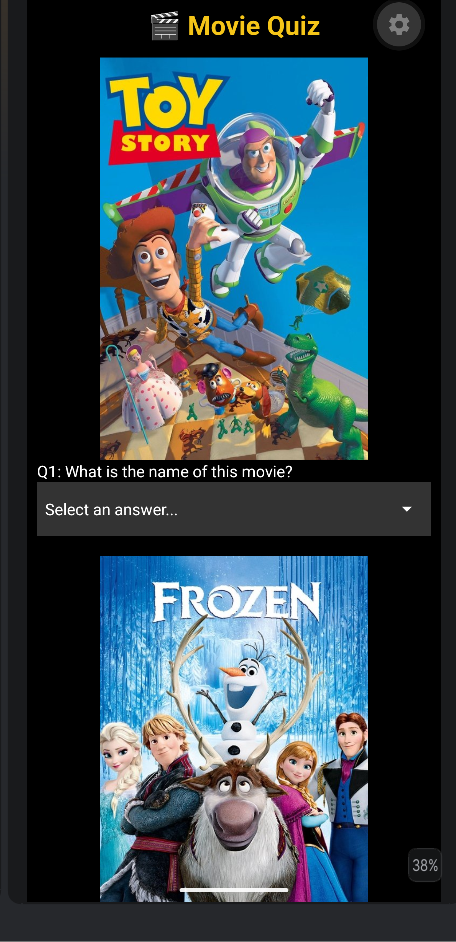
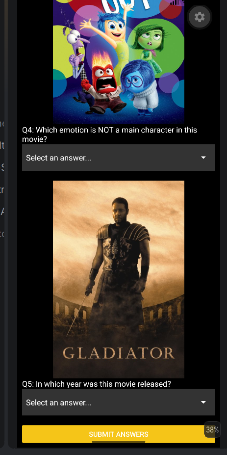
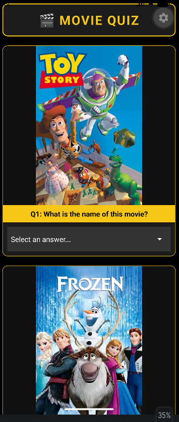
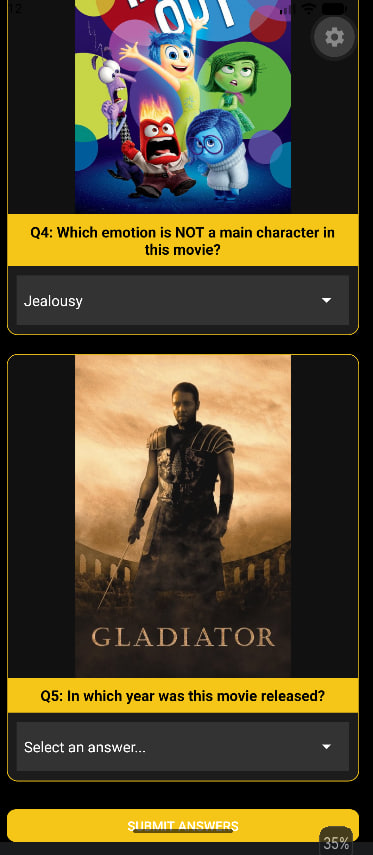
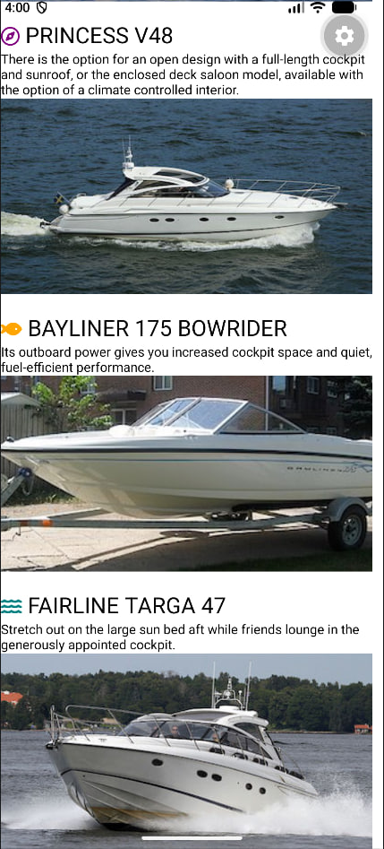
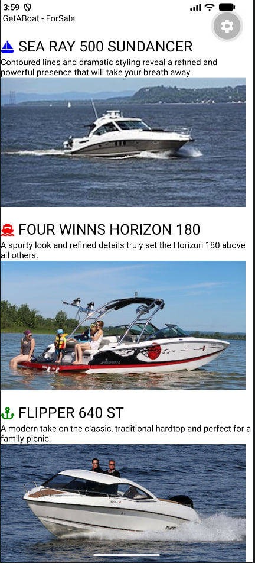
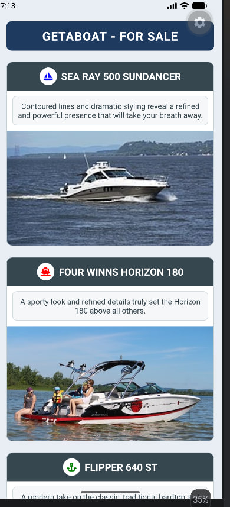
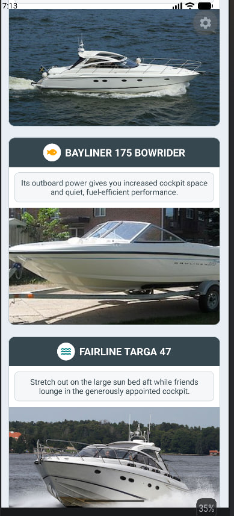

## 🎬 Movie Quiz App

A React Native mobile quiz app that tests the user's knowledge of popular animated and superhero movies. Each question shows a movie poster with a dropdown of 3 answers. After pressing **Submit Answers**, the app shows the user's score and a message.

## ScreenShots of App BEFORE applying Stylesheet changes

Screenshots:

 

## ScreenShots of App AFTER applying Stylesheet changes

Screenshots:

 

## Link to Demo Video with audible narration explaining styling changes with code reference

Demo Video Link: [Watch the demo video](Screenshots/Demo_Video.mp4)

---

## ⛵ GetABoat App

A React Native mobile app that lists boats for sale. Each boat is shown with an icon, its name, a short description and a photo, in a scrollable list.

## ScreenShots of App BEFORE applying Stylesheet changes

Screenshots:

 

## ScreenShots of App AFTER applying Stylesheet changes

Screenshots:

 